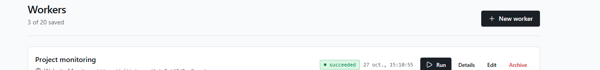
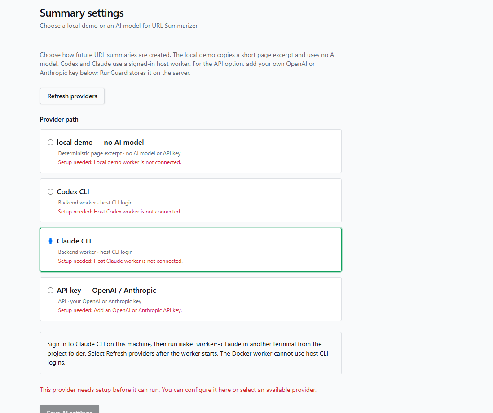

# RunGuard

RunGuard checks websites and summarizes public web pages in background jobs. Save a worker, run it, inspect its logs, and see failures and alerts on a dashboard. The local stack includes a React frontend, FastAPI, a Python job worker, and PostgreSQL.

## Run it locally

You need Docker with Compose and Make. From a fresh clone:

```bash
git clone https://github.com/AutoDotAI/RunGuard.git
cd RunGuard
make compose-up
```

Open **<http://127.0.0.1:3000/signup>** and create an account. No `.env`, API key, Python, or Node.js install is needed for this first run. The URL Summarizer starts in a **local demo** mode that uses no AI model.

```bash
make compose-status  # Check services
make compose-logs    # Show recent app logs
make compose-down    # Stop services; keep your data
```

`make help` lists all commands. Do not use `docker compose down --volumes` with your normal project: it deletes the PostgreSQL data volume.

## Screenshots

**Dashboard** — recent runs, success rates, and alerts.


**Workers** — saved website monitors and URL summarizers.



**AI settings** — local demo, host Codex CLI, host Claude CLI, or your own API key.



## Choose an AI provider

| Choice | What you need |
| --- | --- |
| Local demo | Nothing extra; extracts a short page excerpt without AI. |
| Codex CLI | Sign in to Codex on the host, then run `make install-backend` and `make worker-codex` in another terminal. |
| Claude CLI | Sign in to Claude on the host, then run `make install-backend` and `make worker-claude` in another terminal. |
| API key | Enter an OpenAI or Anthropic key on the AI settings page. A Compose restart is unnecessary. Provider usage may cost money. |

After starting a host CLI worker, select **Refresh providers** on the AI settings page. Keep one job worker connected to the database. API keys are saved encrypted per account on the server; they do not stay in browser storage. There is no automatic job retry or model fallback.

## Tests and local tools

To work on the code, install `uv`, Python 3.12+, Node.js, and npm:

```bash
make install
make test
make typecheck
make build
```

`make check` runs the full local checks. Tests use fake HTTP and model clients; they need no live model key. See the [backend guide](backend/README.md) for API details.

## Observability

Start the app first, then add the optional local telemetry services:

```bash
make compose-up
make observability-up
```

| Tool | Local address | Use |
| --- | --- | --- |
| Grafana | <http://127.0.0.1:3001> | Dashboard and Explore for Prometheus metrics, Loki logs, and Tempo traces. |
| Alertmanager | <http://127.0.0.1:9093> | Grouped firing and resolved alerts. |
| Operator inbox | <http://127.0.0.1:9094> | Local alert notifications. |

Grafana's local development login is `admin` / `admin`. Published ports bind to `127.0.0.1`. Run `make observability-down` to stop telemetry without stopping the site or deleting its data.

RunGuard raises a **repeated run failure** alert after two failed runs in five minutes. It raises a **stalled queue** alert when a run has waited over 60 seconds and the worker heartbeat is missing or older than 15 seconds. Open and resolved alerts appear on the dashboard. The API checks these rules even when no browser is open.

## Incident response

The responder is optional; normal `make compose-up` does not start it. In a second terminal, scan persisted open alerts once or keep scanning every 15 seconds:

```bash
make incident-responder-once
make incident-responder
```

The launcher builds the optional responder image and uses the pinned [AutoDotAI/incident-response](https://github.com/AutoDotAI/incident-response) policy. It reads fixed, redacted run and worker signals, records one incident and an audited decision in PostgreSQL, and deduplicates later scans. **Only** a bound stalled worker in an explicit isolated `rg-demo-*` project can be resumed automatically. For ordinary user incidents, it records a diagnosis and an approval-required or denied decision; it does not edit code or retry jobs. See the [launcher guide](incident-response/README.md) for inspection commands and the isolated `make responder-smoke` drill.

## Project notes

- The app is local only. Public deployment and CD are [deferred](https://github.com/AutoDotAI/RunGuard/issues/34).
- Compose keeps generated PostgreSQL and JWT secrets in a private Docker volume and retains accounts and runs after restart. `make postgres-backup` and `make postgres-restore` support local recovery; see `make help` for the required arguments. Never commit `.env`, keys, or database dumps.
- The existing Lovable frontend stays in `frontend/`.
- The approved scope is in the [specification](_docs/old/SPEC.md). Progress is tracked in [GitHub Issues](https://github.com/AutoDotAI/RunGuard/issues).
