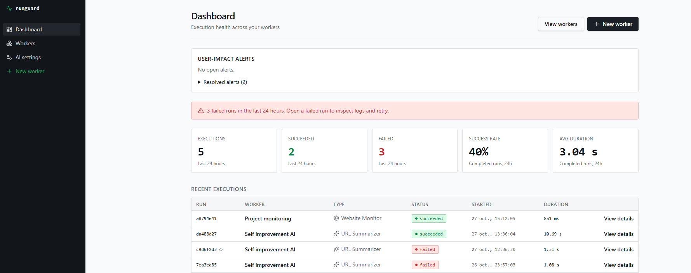

# RunGuard

RunGuard checks websites and summarizes public web pages in background jobs. Save a worker, run it, inspect its logs, and see failures and alerts on a dashboard. The local stack includes a React frontend, FastAPI, a Python job worker, and PostgreSQL.

## Run it locally

You need Docker with Compose and Make. From a fresh clone:

```bash
git clone https://github.com/AutoDotAI/RunGuard.git
cd RunGuard
make compose-up
```

Open **<http://127.0.0.1:3000/signup>** and create an account. No `.env`, API key, Python, or Node.js install is needed for this first run. The URL Summarizer starts in a **local demo** mode that uses no AI model.

```bash
make compose-status  # Check services
make compose-logs    # Show recent app logs
make compose-down    # Stop services; keep your data
```

`make help` lists all commands. Do not use `docker compose down --volumes` with your normal project: it deletes the PostgreSQL data volume.

## Screenshots

**Dashboard** — recent runs, success rates, and alerts.



**Workers** — saved website monitors and URL summarizers.


**AI settings** — local demo, host Codex CLI, host Claude CLI, or your own API key.


## Choose an AI provider

| Choice | What you need |
| --- | --- |
| Local demo | Nothing extra; extracts a short page excerpt without AI. |
| Codex CLI | Sign in to Codex on the host, then run `make install-backend` and `make worker-codex` in another terminal. |
| Claude CLI | Sign in to Claude on the host, then run `make install-backend` and `make worker-claude` in another terminal. |
| API key | Enter an OpenAI or Anthropic key on the AI settings page. A Compose restart is unnecessary. Provider usage may cost money. |

After starting a host CLI worker, select **Refresh providers** on the AI settings page. Keep one job worker connected to the database. See [model provider setup](docs/model-providers.md) for details.

## Tests and local tools

To work on the code, install `uv`, Python 3.12+, Node.js, and npm:

```bash
make install
make test
make typecheck
make build
```

`make check` runs the full local checks. Tests use fake HTTP and model clients; they need no live model key. The [backend guide](backend/README.md) and [local script inventory](docs/local-scripts.md) cover additional commands.

To add local observability, run `make observability-up`. Open [Grafana](http://127.0.0.1:3001) for Prometheus metrics, Loki logs, and Tempo traces. [Alertmanager](http://127.0.0.1:9093) and the [operator inbox](http://127.0.0.1:9094) are also available. See [observability](docs/observability.md) and the [incident response launcher](incident-response/README.md).

## Project notes

- The app is local only. Public deployment and CD are [deferred](https://github.com/AutoDotAI/RunGuard/issues/34).
- Compose keeps PostgreSQL credentials in a private Docker volume and retains accounts and runs after restart. See [local recovery](docs/local-recovery.md) before importing old SQLite data or restoring a backup.
- The existing Lovable frontend stays in `frontend/`; see [Lovable sync](_docs/lovable-sync.md).
- The approved scope is in the [specification](_docs/old/SPEC.md). Progress is tracked in [GitHub Issues](https://github.com/AutoDotAI/RunGuard/issues), with [reviewer evidence](docs/reviewer-evidence.md) and a [course criteria audit](docs/zoomcamp-evidence.md).
